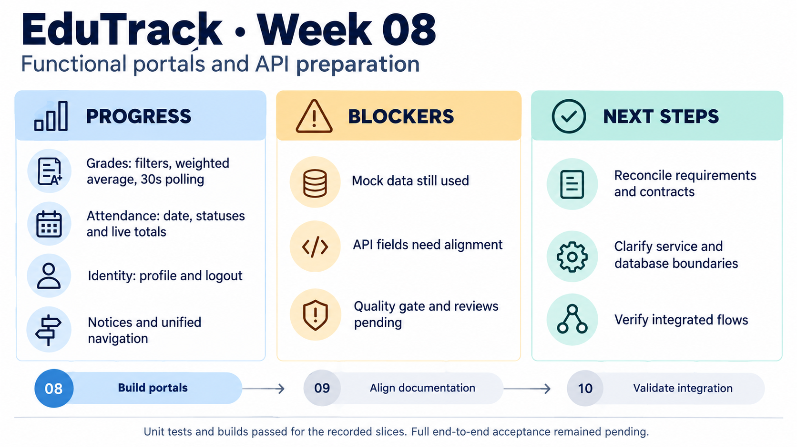

<!-- HU-STATUS TEMPLATE - do NOT remove the <!-- ... --> markers or the table headers.
     Your weekly grade is read AUTOMATICALLY from this file:
       08-week/hu-status/README.md  (inside YOUR fork). English. -->

# Weekly Status - Week 08

<!-- CONFIG-START - must match your profile repo (username/username) CONFIG -->
- FULL_NAME: Maria Celeste Dussan
- GITHUB_USER: CelesteDussan
- TEAM: G1
- SPRINT_GOAL: Build testable EduTrack portal features and prepare their API integration while keeping mock behavior and remaining acceptance gaps explicit.
<!-- CONFIG-END -->

## 1. User stories worked this week
| HU ID | Title | Status (todo/doing/done) | Evidence (PR or commit URL) |
|---|---|---|---|
| HU-001 | Grade filtering, weighted average and API polling | doing | [Grade UI PR #4](https://github.com/code-corhuila/educk-academic-portal/pull/4) · [API polling PR #6](https://github.com/code-corhuila/educk-academic-portal/pull/6) |
| HU-003 | Session profile, role badges and logout | doing | [Identity PR #7](https://github.com/code-corhuila/educk-identity-portal/pull/7) |
| HU-004 | Institutional notices, filters and read state | doing | [Communication PR #8](https://github.com/code-corhuila/educk-communication-portal/pull/8) |
| HU-005 | Dated attendance session and live totals | doing | [Attendance PR #5](https://github.com/code-corhuila/educk-attendance-portal/pull/5) |

Reporting period: **September 21-27, 2026 (America/Bogota)**. Reconstructed on October 11 from dated commit evidence. Status refers to each complete story, not just its implemented UI slice. The next-week plan is reconstructed from unresolved work and the following week's evidence; it is not a verbatim historical plan.

## 2. My individual contribution
- Implemented the guardian grade view with subject filtering, weighted averages and performance indicators; added boundary tests for average classification.
- Added a configurable Academic API client, optional bearer authentication, 30-second polling, cancellation, retry and an explicit demonstration fallback.
- Built the attendance date selector, PRESENT/ABSENT/LATE/EXCUSED controls and live totals. Saving this slice was a local confirmation without HTTP persistence.
- Added the Identity session profile, institutional role badges, accessible credential errors and logout using contract-shaped mock data and memory-only access tokens.
- Added notice category/date filters, locally persisted read state, an accessible dialog and keyboard focus restoration.
- Unified satellite navigation in the shell with a module registry, active portal state and responsive iframe navigation ([shell PR #11](https://github.com/code-corhuila/educk-front/pull/11)).
- Updated the notification worker OpenAPI contract and C4 context on September 23, continuing Week 7's contract and service-boundary work.

## 3. Blockers and risks
- The grade UI still needed backend enrichment for subjectName, activityTitle and weight. Client tests and fallback data did not establish real API acceptance.
- Attendance saving and Identity authentication were simulated in these slices; database persistence and the complete authenticated flow remained unverified.
- Academic PR #4 initially failed the Cloud Guardian quality gate on September 25. PR creation and local tests were not sufficient to declare it ready; formal reviews and integration had to be checked separately.
- Communication and the shell retained two pre-existing Vite-related audit findings, one moderate and one high. Dependency upgrades were kept separate from the small feature PRs.
- Requirements, service naming and implementation evidence were scattered across repositories. The larger HU-004 integration remained open even though Week 7 had described its earlier MVP 1 walking skeleton as delivered.

## 4. Plan for next week
- Reconcile the backlog, functional requirements and traceability with the portal work and actual service contracts.
- Clarify canonical events, service ownership, isolated databases and environment deployment rules.
- Review the small official-repository PRs, resolve failing checks and confirm integration without treating merge as full story acceptance.
- Continue API integration and collect real producer-to-consumer evidence for the grade and absence flows; preserve explicit mock limitations until then.

## 5. Compliance self-check
- [x] Conventional Commits - `type(scope): summary`
- [ ] Per-environment HU branch + PR to that environment (hu-xxx-dev -> develop, ...)
- [x] Testable acceptance criteria
- [x] Tests added/updated (unit / integration)
- [ ] DDD / hexagonal boundaries respected (domain has no I/O)
- [x] No secrets; config via environment variables

The test checkbox covers the recorded frontend unit tests, not full integration. Feature branches targeted develop but did not use the syllabus hu-xxx-dev naming. A complete backend hexagonal audit was not performed in this report.

## 6. Evidence links
- [Grade UI and weighted average commit](https://github.com/code-corhuila/educk-academic-portal/commit/4c7150858e6d95c1fa2b25884c6d751b780ebd8c)
- [Average classification tests](https://github.com/code-corhuila/educk-academic-portal/commit/bbc2e75afa49a54bd3aa4bae1c39b3f2b03b14dc)
- [Academic API polling commit](https://github.com/code-corhuila/educk-academic-portal/commit/f150b884bceac6fea81e2eac8cc1dff2166ac76e)
- [Attendance session commit](https://github.com/code-corhuila/educk-attendance-portal/commit/195105c0bc236e6557c701a882aff9160c5be403)
- [Identity profile commit](https://github.com/code-corhuila/educk-identity-portal/commit/a60627b57054c1565580ddef2b8c529e303c7053)
- [Notices commit](https://github.com/code-corhuila/educk-communication-portal/commit/92bf81ed02b75a08cfe094cfe2b0d01a7f5228ec)
- [Shell navigation commit](https://github.com/code-corhuila/educk-front/commit/c844cacd6095964d0c7c80dedd4f6343051e896e)
- [Worker OpenAPI correction](https://github.com/code-corhuila/educk-docs/commit/e055d17c8f8267980885d00bb2939ec5ef69fae1) · [C4 alignment](https://github.com/code-corhuila/educk-docs/commit/034cec7e9e2456c36cedab3a97ca848830981477)

### Recorded validation

These are historical results for the commits above, not tests rerun when writing this report.

| Scope | Recorded result | Limit |
|---|---|---|
| Academic | 5/5 initial tests, 7/7 after classification tests, 14/14 after API work; builds passed | Successive suites, not additive; real backend acceptance unverified |
| Attendance | 6/6 tests; build passed; UI checked at 320/768/1024 px | Save had no HTTP call |
| Identity | 6/6 tests; build passed; error/profile/logout checked | Mock authentication |
| Communication | 6/6 tests; build passed; filtering, read state and Escape checked | Local read state, not server persistence |
| Shell | 4/4 tests; lint/build passed; desktop, 768 px and 320 px checked | Shared-session end-to-end behavior unverified |
| Documentation | OpenAPI validation and Mermaid rendering passed | OpenAPI retained three non-blocking warnings |

## 7. Learning from the implementation

Pure calculations and adapters made the portals testable before complete backend integration. A successful production build, a passing unit suite and a usable mock screen answer different questions; none alone proves database persistence or full story acceptance. Small PRs helped keep those boundaries reviewable.

## 8. EduTrack project progress - Week 8

Week 7 identified service blocks and contracts. This week turned them into concrete portal features and testable client behavior. The unresolved contract and ownership gaps lead into [Week 9](../../09-week/hu-status/README.md).
