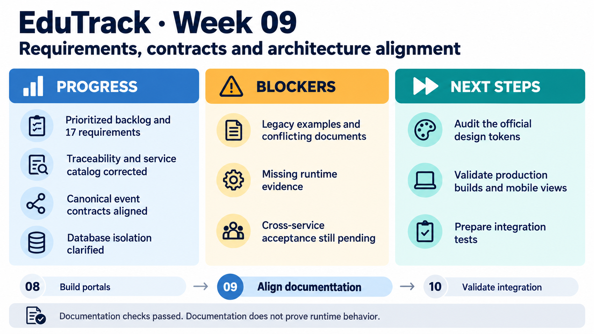

<!-- HU-STATUS TEMPLATE - do NOT remove the <!-- ... --> markers or the table headers.
     Your weekly grade is read AUTOMATICALLY from this file:
       09-week/hu-status/README.md  (inside YOUR fork). English. -->

# Weekly Status - Week 09

<!-- CONFIG-START - must match your profile repo (username/username) CONFIG -->
- FULL_NAME: Maria Celeste Dussan
- GITHUB_USER: CelesteDussan
- TEAM: G1
- SPRINT_GOAL: Reconcile EduTrack requirements, traceability, service and event contracts, and database isolation with the implemented portal slices.
<!-- CONFIG-END -->

## 1. User stories worked this week
| HU ID | Title | Status (todo/doing/done) | Evidence (PR or commit URL) |
|---|---|---|---|
| HU-001 | Grade-flow requirements and traceability | doing | [Functional requirements PR #25](https://github.com/code-corhuila/educk-docs/pull/25) · [Traceability PR #27](https://github.com/code-corhuila/educk-docs/pull/27) |
| HU-002 | Absence-event contract and causal ordering | doing | [Canonical events PR #31](https://github.com/code-corhuila/educk-docs/pull/31) · [Event catalog PR #32](https://github.com/code-corhuila/educk-docs/pull/32) |
| HU-003 | Identity scope and service ownership | doing | [Service boundaries PR #29](https://github.com/code-corhuila/educk-docs/pull/29) · [Service catalog PR #30](https://github.com/code-corhuila/educk-docs/pull/30) |
| HU-004 | Communication scope and acceptance traceability | doing | [Backlog PR #24](https://github.com/code-corhuila/educk-docs/pull/24) · [Traceability PR #27](https://github.com/code-corhuila/educk-docs/pull/27) |
| HU-005 | Attendance requirements and data ownership | doing | [Functional requirements PR #25](https://github.com/code-corhuila/educk-docs/pull/25) · [Database isolation PR #33](https://github.com/code-corhuila/educk-docs/pull/33) |

Reporting period: **September 28-October 4, 2026 (America/Bogota)**. Reconstructed on October 11 from dated commit evidence. This week's contribution was documentation supporting these stories; it does not claim new implementation of every story. The next-week plan is reconstructed from unresolved work and the following week's evidence.

## 2. My individual contribution
- Corrected the C4 context and rendered it to verify the diagram. Added a prioritized MVP 1 backlog and canonical functional requirements on September 28.
- Clarified traceability gaps and causal ordering, then replaced inherited examples with 17 actual functional-requirement rows and explicit evidence gaps.
- Updated the project overview and contribution workflow to reference the official repositories and current implementation dependencies.
- Reconciled service boundaries and the service catalog, including repository names, ports and ownership.
- Aligned the canonical event contracts and derived catalog around the two approved events, GradeCreated and StudentAbsent, including envelope fields and routing keys.
- Clarified ADR-003: each domain needs its own database instance and persistent volume; logical UUID references replace physical cross-service foreign keys; migrations belong in the corresponding database repository.
- Documented separate develop, qa and main deployments, externalized configuration and fail-closed secret variables. Submitted changes as small one-file documentation PRs without modifying governance.

## 3. Blockers and risks
- Inherited order-service examples, obsolete HU identifiers and unsupported completion/test claims made the old traceability unreliable; the documented corrections addressed those inconsistencies.
- Service and event descriptions had diverged between canonical and derived documents. Correcting the documents did not automatically update implementations or establish runtime conformance.
- Real API integration, persistence, event deduplication and complete UI-to-service acceptance still lacked sufficient evidence for Done.
- Documentation and portal PR integration did not remove the need for runtime validation or formal environment promotion.

## 4. Plan for next week
- Audit the portals against the 72 canonical design tokens and reconcile visual differences with the documented design system.
- Verify production bundles, shared-client dependencies, narrow viewports and keyboard interactions.
- Prepare integrated frontend checks with explicit test-data assumptions; distinguish simulated responses from real authentication and database persistence.
- Review CI and pending approvals, then coordinate shared-session behavior and the infrastructure needed for real end-to-end tests.

## 5. Compliance self-check
- [x] Conventional Commits - `type(scope): summary`
- [ ] Per-environment HU branch + PR to that environment (hu-xxx-dev -> develop, ...)
- [x] Testable acceptance criteria
- [ ] Tests added/updated (unit / integration)
- [ ] DDD / hexagonal boundaries respected (domain has no I/O)
- [x] No secrets; config via environment variables

These were documentation PRs to main under the agreed documentation workflow, not per-environment HU implementation PRs. No new unit/integration suite or full backend boundary audit is claimed; documentation validation is recorded below.

## 6. Evidence links
- [C4 context correction](https://github.com/code-corhuila/educk-docs/commit/b6752836724d007d5dacff597ef263718d2c1a6e)
- [Prioritized backlog](https://github.com/code-corhuila/educk-docs/commit/116ca5d3fa8377556300cc39d840ffb38c49d898)
- [Functional requirements](https://github.com/code-corhuila/educk-docs/commit/ccf75556c5b0c786a22d15cff7412cb3ac0375fa) · [Traceability clarification](https://github.com/code-corhuila/educk-docs/commit/96fccaa0a22da138e456e87f33aca836f4325559)
- [Traceability matrix replacement](https://github.com/code-corhuila/educk-docs/commit/33f75edcb9137f9d81878ffbd22d64ba1c6ed5c3)
- [Service boundaries](https://github.com/code-corhuila/educk-docs/commit/db743857431355f581754b6c12a78144a9ad106f) · [Service catalog](https://github.com/code-corhuila/educk-docs/commit/4268c9c0ebb0e8e1d3c06dc857d09fe14d70fce8)
- [Canonical event contracts](https://github.com/code-corhuila/educk-docs/commit/2696eea537da3a84a7f80a3ec7bfb6237ebb1ed5) · [Derived event catalog](https://github.com/code-corhuila/educk-docs/commit/c3df96d93f07d416b7d0610ecaad1d8189843fdf)
- [Database isolation](https://github.com/code-corhuila/educk-docs/commit/0390dbd59470e28accecf2e005a2c23a3c2bd942) · [Deployment environments](https://github.com/code-corhuila/educk-docs/commit/9246c5586384815bdb8a71c5b029f1a90a13fd28)

### Recorded validation

| Scope | Historical result | Limit |
|---|---|---|
| C4 context | Mermaid produced SVG/PNG; PNG visually inspected; diff check passed | Diagram validation, not a deployed topology test |
| Requirements and traceability | 17 unique FR identifiers/rows; relative links checked; inherited examples removed | Evidence gaps remained explicit |
| Events | Two JSON examples parsed; envelope, routing keys and relative links checked; derived catalog had two approved events | No consumer-driven or broker runtime test added |
| Boundaries and environments | Ownership, instances, volumes, environment separation and fail-closed variables checked in the documentation | Actual deployment isolation not demonstrated by these edits |
| PR scope | One file per documentation PR; recorded diffs below 400 changed lines | Formal review and mandatory checks are separate requirements |

A later GitHub observation on **October 5** recorded documentation PRs #23-#34 as merged, with integration timestamps on September 29-30 UTC. This is retrospective integration evidence, not a claim that the observation occurred during Week 9 or that every HU was complete. The original commit links above preserve authorship even where integration created another SHA.

## 7. Learning from the implementation

Traceability must connect a real requirement to its implementation and validation, including honest gaps. Canonical contracts reduce contradictory descriptions. Database-per-service requires isolated ownership and storage; environment isolation is an additional deployment boundary, not merely a naming convention.

## 8. EduTrack project progress - Week 9

[Week 8](../../08-week/hu-status/README.md) produced portal slices and exposed alignment gaps. This week corrected the documented baseline so [Week 10](../../10-week/hu-status/README.md) could focus on production behavior and integration validation.
