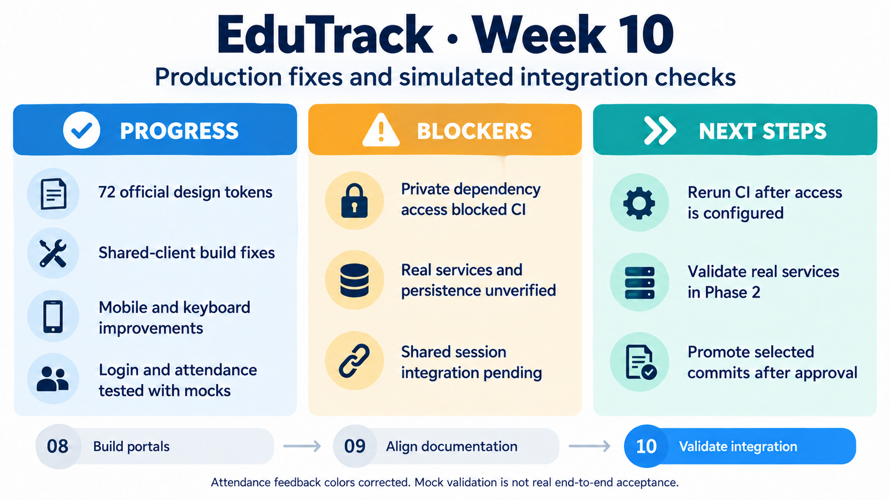

<!-- HU-STATUS TEMPLATE - do NOT remove the <!-- ... --> markers or the table headers.
     Your weekly grade is read AUTOMATICALLY from this file:
       10-week/hu-status/README.md  (inside YOUR fork). English. -->

# Weekly Status - Week 10

<!-- CONFIG-START - must match your profile repo (username/username) CONFIG -->
- FULL_NAME: Maria Celeste Dussan
- GITHUB_USER: CelesteDussan
- TEAM: G1
- SPRINT_GOAL: Apply the official design system, repair production and responsive issues, and validate Identity and Attendance with explicit Phase 1 simulation limits before real-service QA.
<!-- CONFIG-END -->

## 1. User stories worked this week
| HU ID | Title | Status (todo/doing/done) | Evidence (PR or commit URL) |
|---|---|---|---|
| HU-001 | Official grade-view tokens and mobile layout | doing | [Tokens PR #7](https://github.com/code-corhuila/educk-academic-portal/pull/7) · [Mobile PR #8](https://github.com/code-corhuila/educk-academic-portal/pull/8) |
| HU-003 | Identity tokens, shared client and responsive login | doing | [Tokens PR #13](https://github.com/code-corhuila/educk-identity-portal/pull/13) · [Build PR #14](https://github.com/code-corhuila/educk-identity-portal/pull/14) · [Responsive PR #15](https://github.com/code-corhuila/educk-identity-portal/pull/15) |
| HU-004 | Communication tokens, mobile views and keyboard access | doing | [Tokens PR #10](https://github.com/code-corhuila/educk-communication-portal/pull/10) · [Mobile PR #11](https://github.com/code-corhuila/educk-communication-portal/pull/11) |
| HU-005 | Attendance client, CI dependency and feedback states | doing | [Client/CI PR #8](https://github.com/code-corhuila/educk-attendance-portal/pull/8) · [Feedback commit](https://github.com/code-corhuila/educk-attendance-portal/commit/37180260f9f6c7c44df236ba15c2ff2715882e26) |

Reporting period: **October 5-11, 2026 (America/Bogota)**. Reconstructed on October 11; the latest implementation entry available for this report is dated October 9. PR and CI observations below are historical and explicitly dated, not live status assertions. The next-week plan follows the remaining blockers and the agreed delivery workflow.

## 2. My individual contribution
- Checked earlier portal and documentation PR integration on October 5, preserving original commits and separate integration SHAs in the local evidence log.
- Applied the 72 canonical design tokens and Inter typography to the shell and four portals on October 6, following the documented design system over older mockups.
- Fixed shared-client bundling in Identity and Attendance after production imports failed. Corrected Academic header overflow, Communication mobile/dialog behavior and Identity labels, focus and narrow-screen layout.
- Updated Attendance CI to check out the shared client, then reference the team-provisioned read-only GH_FRONT_READ_TOKEN secret on October 7. No secret value was accessed or stored.
- Corrected remaining legacy Identity accent colors on October 8. Combined overlapping proposals only in a separate local validation copy to test tokens, responsive markup and shared-client fixes together.
- Validated combined Identity/Attendance production copies in headless Edge at 320, 768 and 1440 px: login error/retry/session/redirect and attendance totals/save/error/retry worked against simulated responses, with no uncaught browser errors.
- Found that Attendance displayed failures with success-colored styling, then committed distinct information, success and error states on hu-005-dev on October 9; local browser checks confirmed green success, red failure and an enabled retry.

## 3. Blockers and risks
- Attendance CI run 37692244361 failed on October 7 because the private dependency checkout did not receive its required token. Local passing tests did not resolve this remote CI blocker; teammate provisioning/access confirmation remained necessary.
- The October 8 clarification established that the official Compose was intentionally Phase 1: infrastructure plus Mock Server on port 3001, without the real Gateway or Java services. Real authentication, service/database connectivity and durable persistence were not validated.
- Mock port 3001 collided with Identity. The separate local harness used ports 4301 and 4303 and contract adapters; it did not constitute acceptance of the unmodified official deployment.
- The simulated login did not verify passwords, the redirect ended at a mock confirmation page, and Attendance saves were memory-only using the existing demo roster. None demonstrates real shared-shell session behavior.
- The teammate owned shell/session integration using edutrack_session. Same-origin behavior still needed verification after that integration became available.
- Identity token and responsive proposals overlapped in Login.jsx; reviewed integration needed to preserve both. Communication's React migration also needed inspection before adapting further changes.
- Required reviews, approved integration and environment promotion remained separate gates. The October 9 feedback commit's push/PR status was not verified in the available creation entry.

## 4. Plan for next week
- Confirm that the teammate configured private dependency access, rerun Attendance CI and check the result rather than assuming that the workflow edit fixed it.
- Reconcile overlapping Identity changes after approved integration and verify the actual shared shell, same-origin session storage, redirect and logout behavior.
- Repeat runtime tests on Phase 2 once real services are published: service startup, database connectivity, real authentication, durable attendance saving and visible UI behavior.
- After verified development approval/integration, promote selected commits individually with cherry-pick -x into hu-<id>-qa branches from current qa; record each new SHA and source SHA.
- After QA testing and approval, use per-HU release PRs based on the release.2.x.x branch created by the teammate. Prepare evidence for the October 13 deadline; leave final integration to main and official tagging to the authorized approval process.

## 5. Compliance self-check
- [x] Conventional Commits - `type(scope): summary`
- [ ] Per-environment HU branch + PR to that environment (hu-xxx-dev -> develop, ...)
- [x] Testable acceptance criteria
- [ ] Tests added/updated (unit / integration)
- [ ] DDD / hexagonal boundaries respected (domain has no I/O)
- [x] No secrets; config via environment variables

Existing unit suites were rerun and simulated browser checks were added locally; the unchecked tests item avoids claiming new committed unit/integration coverage for these UI fixes. Earlier PRs retained their original branch names, and the new hu-005-dev commit did not yet have verified PR evidence. No full backend hexagonal audit is claimed.

## 6. Evidence links
- [Shell tokens PR #14](https://github.com/code-corhuila/educk-front/pull/14) · [Attendance tokens PR #7](https://github.com/code-corhuila/educk-attendance-portal/pull/7)
- [Identity shared-client build fix](https://github.com/code-corhuila/educk-identity-portal/commit/460615e40f2d7938797c3d53d1f5d34529cad339)
- [Attendance shared-client build fix](https://github.com/code-corhuila/educk-attendance-portal/commit/03e6797a1bdfa538d7fc9039f363bb94c36c7ed3)
- [Academic mobile correction](https://github.com/code-corhuila/educk-academic-portal/commit/0402916bdadab52e1496a61ef40b1254d2fac016)
- [Communication mobile and keyboard correction](https://github.com/code-corhuila/educk-communication-portal/commit/bd4b55fe5ccfac20c1b03927631ab100fac15657)
- [Identity responsive login](https://github.com/code-corhuila/educk-identity-portal/commit/22bcbf6fcbf54c4a9094ea9eec6db271ee6c3769)
- [Attendance private-checkout authentication](https://github.com/code-corhuila/educk-attendance-portal/commit/86d53ef3ffcc3686ab3b329ff1d5d57bbfb8a95a)
- [Failed Attendance CI run observed October 7](https://github.com/code-corhuila/educk-attendance-portal/actions/runs/37692244361)
- [Identity palette correction](https://github.com/code-corhuila/educk-identity-portal/commit/9a15fc64c1673faa16bc1bfa5e40bc2250ed5116)
- [Attendance semantic feedback correction](https://github.com/code-corhuila/educk-attendance-portal/commit/37180260f9f6c7c44df236ba15c2ff2715882e26)

### Recorded validation

| Scope/date | Historical result | Limit |
|---|---|---|
| Token work, October 6 | Shell 8, Identity 9, Attendance 6, Communication 6 and Academic 14 tests passed | Separate suites; initial Identity/Attendance bundle failures required the independent fixes |
| Build/mobile fixes, October 6 | Identity 9/9, Attendance 6/6, Academic 14/14, Communication 6/6; production builds and diff checks passed | Identity responsive validation applied the independent build fix in a temporary configuration |
| Attendance CI, October 7 | Local 6/6 tests and build passed; Cloud Guardian succeeded; private checkout CI failed | Remote CI remained blocked on secret availability |
| Combined validation, October 8 | Production builds passed; Identity 9/9; both portals matched 72/72 tokens; HTTP and browser error/retry flows passed | Separate combined copies, mocked responses, no real authentication or persistence |
| Feedback fix, October 9 | Attendance 6/6; build/diff check passed; green success and red network failure confirmed | Local runtime combined the existing client/token proposals; publication not verified |

The October 8 browser evidence superseded an earlier browser-tool initialization failure after recovery with bundled Playwright and headless Edge. Historical local sources were COMMIT-EVIDENCE.md, tmp/PHASE1-VALIDATION.md and tmp/phase1-qa/browser-evidence/results.json in the working workspace; these are provenance references, not published attachments or portable links. No tests were rerun merely to reconstruct this report.

## 7. Learning from the implementation

A production bundle can expose dependency failures that development mode hides. CI must reproduce dependency access as well as build commands. Mock validation is useful for error handling, layout and retry behavior, but real-service acceptance additionally requires authentication, database persistence and the actual shared session. Semantic feedback is part of correctness: a failed save must not look successful.

## 8. EduTrack project progress - Week 10

[Week 8](../../08-week/hu-status/README.md) built the portal features and [Week 9](../../09-week/hu-status/README.md) aligned their documented baseline. This week tested production behavior and corrected visible failures. The remaining work is approved integration and real-service QA, so the complete stories remain doing.
