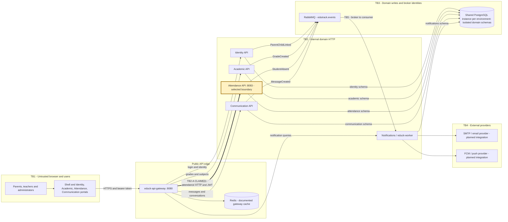

# CP1 - EduTrack attack surface

## Sources and scope

Sources: official `educk-docs` main at `2ec113d0933cf73daf4c6e5ce93ce65836d2ee2d`:
[product vision](https://github.com/code-corhuila/educk-docs/blob/main/03-product/vision.md),
[architecture](https://github.com/code-corhuila/educk-docs/blob/main/05-architecture/overview.md),
[JWT ADR](https://github.com/code-corhuila/educk-docs/blob/main/05-architecture/decisions/records/ADR-006-api-gateway-jwt.md),
and [Attendance](https://github.com/code-corhuila/educk-docs/blob/main/09-microservices/services/05-attendance/README.md).
Code evidence: `educk-attendance-api` develop at `8b1cf52501a6b994a5adb2c3918591e28a80684d`.
This maps intended system flows; it does not certify a deployed environment.

## Data flow and trust boundaries

Each schema arrow is a separate ownership boundary inside the shared engine.
Annex J supersedes older per-domain instances in the docs. MongoDB is required
by Annex J, but its domain assignment is not established by these sources;
it is an unresolved architecture requirement, not an invented running service.
The docs mix old monolith descriptions, service ports and contract paths.
Redis and external providers are documented targets, not verified runtime controls.

## Asset inventory

| Asset | Location / owner | Classification | Boundary use |
|---|---|---|---|
| JWT bearer credential | Browser, gateway, Attendance security filter | restricted | Authentication |
| Student and school UUIDs | Attendance request and Identity records | confidential | Tenant and subject selection |
| Attendance status and date | `attendance.attendance_events` | confidential | Write and query payload |
| Teacher UUID and authorities | JWT context; current write body includes teacherId | confidential | Actor attribution and permission |
| Sequence number | Attendance write and event history | internal | Causal integrity |
| StudentAbsent event | Attendance outbox / RabbitMQ / worker | confidential | Downstream notification effect |
| Request correlation and audit metadata | Service logs | internal | Investigation without bearer tokens |

## Selected boundary entry points

| Entry point | Caller and port | Current authentication / authorization |
|---|---|---|
| `POST /api/v1/attendance` | Portal through Gateway :8080 to Attendance :8083 | JWT filter; authenticated principal required; no endpoint role rule in inspected SecurityConfig |
| `GET /api/v1/attendance/student/{studentId}` | Gateway or direct internal caller, :8083 | JWT required; controller passes studentId without a principal/relationship check |
| `GET /api/v1/attendance` | Gateway or direct internal caller, :8083 | JWT required; controller exposes all records through GetAttendanceUseCase |
| `/api/v1/attendance/health` | Health probe, :8083 | Public; exclude student data and credentials |

The code paths above are implemented in `AttendanceController`; the docs also
describe `POST /sessions` and `/api/v1/students/{studentId}/attendance`.
Those are contract/documentation discrepancies, not interchangeable tested routes.
No queue enters the selected inbound HTTP boundary; RabbitMQ is a downstream trust boundary.
ADR-006 describes gateway identity headers, while Attendance validates bearer tokens.
Header trust, issuer/audience validation, TLS and network isolation need separate verification.
The observed authenticated-only rule does not prove teacher, school or parent-child authorization.
